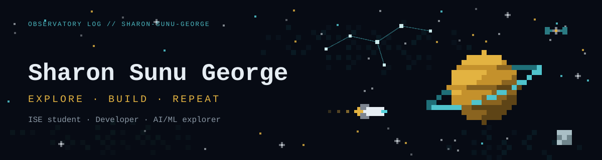

## About Me

- Information Science and Engineering student at Acharya Institute of Technology, Bangalore
- Student developer and AI/ML explorer, learning by building projects
- Currently learning AI/ML and improving my Python and web development skills
- Interested in React, JavaScript, and learning open source by reading real repositories

## Tech Stack & Tools

### Languages

### Frameworks & Tools

## Projects

- **[CyberSentinal](https://github.com/gaganhm3018-art/CyberSentinal)**: a collaborative website security assessment project, with risk analysis and a dashboard of findings.
- **[RepoDetective](https://github.com/Sharon-Sunu-George/RepoDetective)**: an AI-assisted way to learn open-source codebases. Concept, in progress.

## Beyond the Screen

Space, anime, books, and story-driven games.

## Connect

